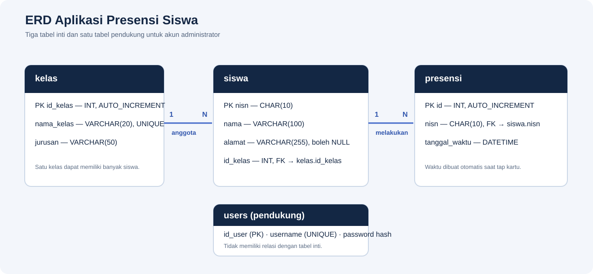
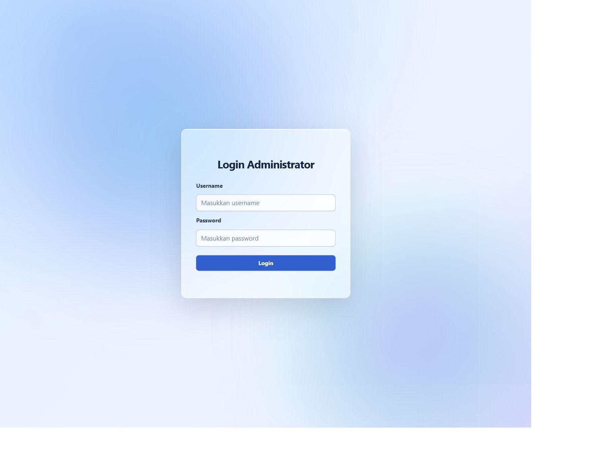
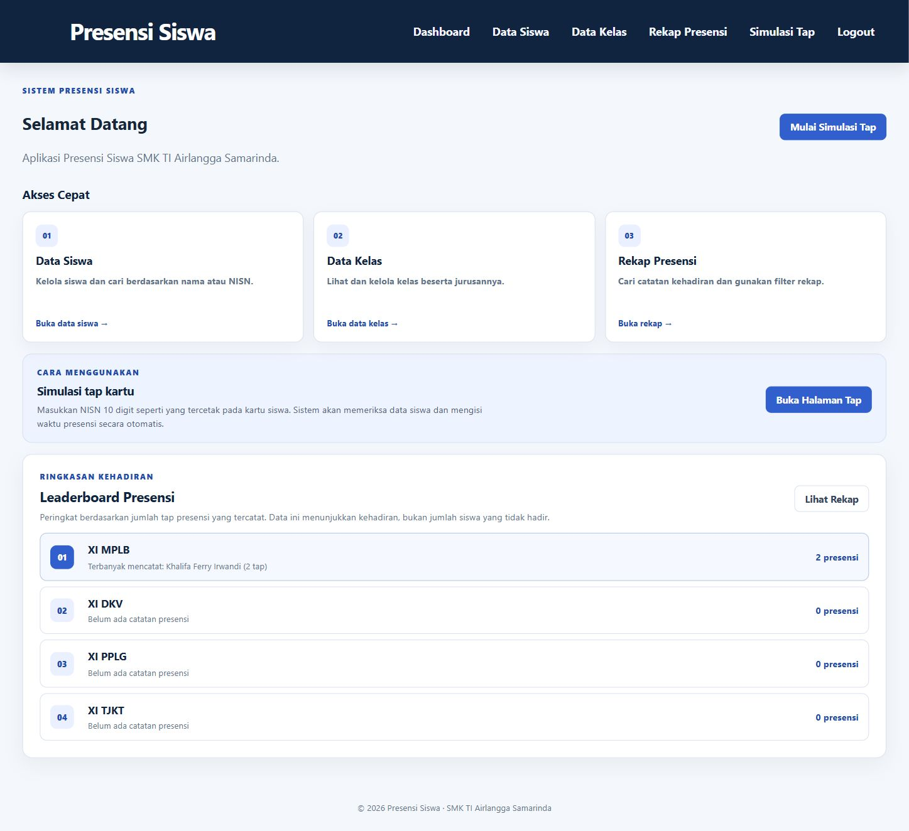
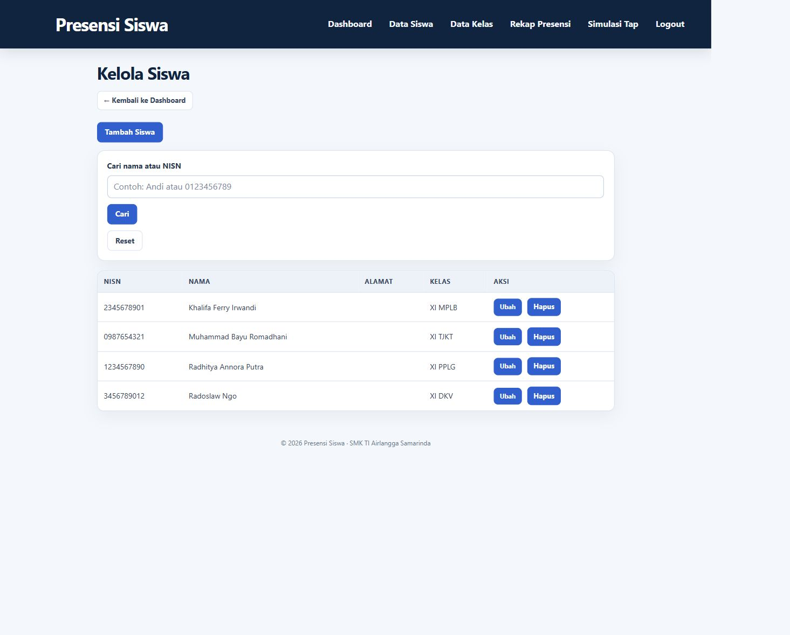
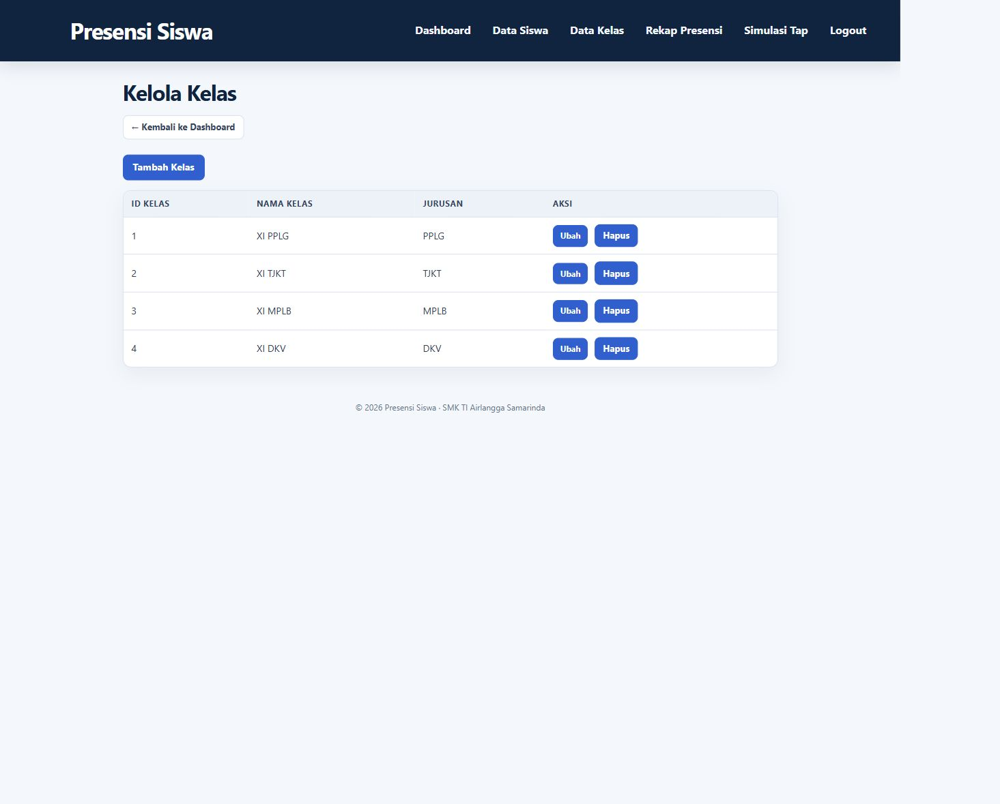
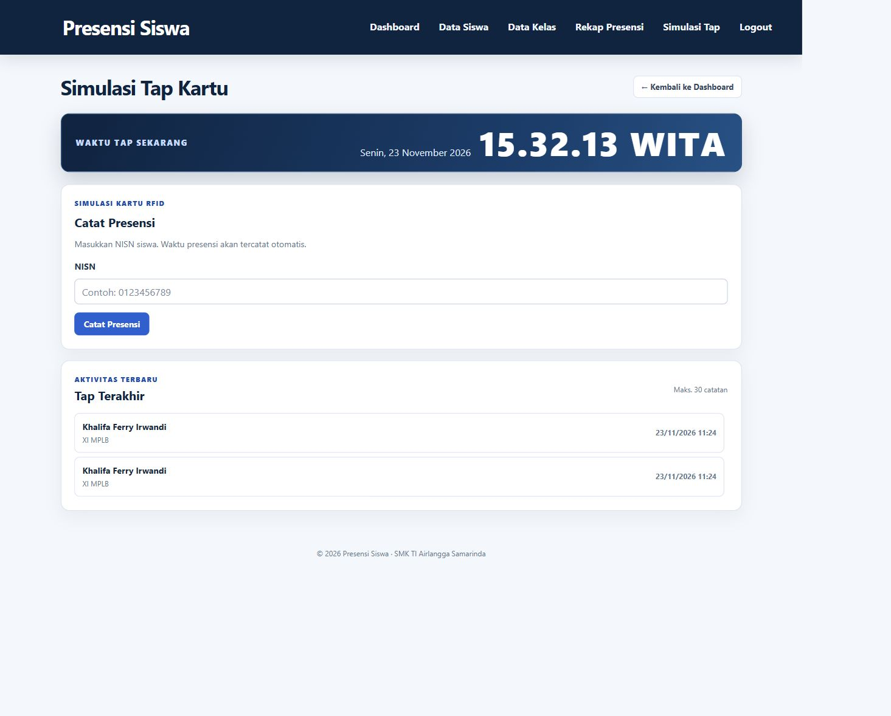
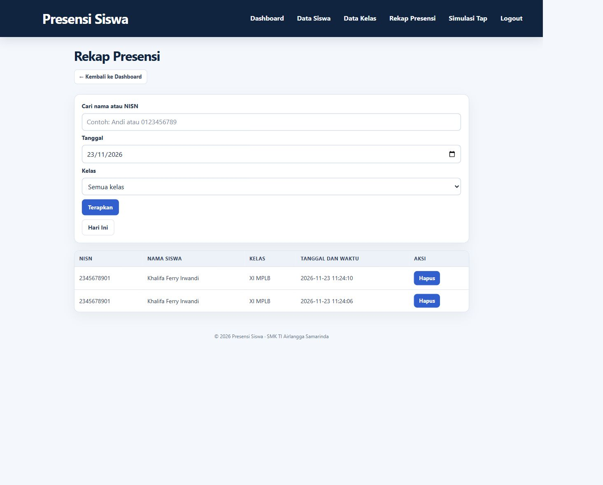

# Aplikasi Presensi Siswa

Aplikasi web untuk mengelola data kelas dan siswa serta mencatat kehadiran melalui simulasi tap kartu RFID berbasis NISN. Aplikasi dibuat sebagai proyek UKK menggunakan PHP native, PDO, OOP, dan MariaDB.

## Fitur

- Login dan logout administrator dengan session.
- CRUD kelas, termasuk pemeriksaan nama kelas duplikat dan larangan menghapus kelas yang masih memiliki siswa.
- CRUD siswa dengan pencarian nama/NISN dan validasi NISN 10 digit.
- Simulasi tap kartu; waktu presensi dibuat otomatis oleh database.
- Rekap presensi dengan pencarian nama/NISN, filter tanggal dan kelas, serta penghapusan log.
- Dashboard ringkasan leaderboard kelas berdasarkan jumlah catatan presensi.
- Layout responsif untuk desktop dan smartphone.

## Teknologi

- PHP native 8+ dan PDO
- MariaDB / MySQL
- HTML, CSS, dan JavaScript
- Laragon untuk lingkungan lokal

## Instalasi lokal

1. Jalankan **Apache** dan **MySQL** dari Laragon.
2. Letakkan folder proyek di `C:\laragon8\www\Presensi RFID`.
3. Buat database `presensi_rfid` melalui phpMyAdmin.
4. Buat tabel dengan DDL berikut (jalankan berurutan):

```sql
CREATE DATABASE IF NOT EXISTS presensi_rfid
  CHARACTER SET utf8mb4 COLLATE utf8mb4_unicode_ci;
USE presensi_rfid;

CREATE TABLE kelas (
  id_kelas INT AUTO_INCREMENT PRIMARY KEY,
  nama_kelas VARCHAR(20) NOT NULL UNIQUE,
  jurusan VARCHAR(50) NOT NULL
) ENGINE=InnoDB;

CREATE TABLE siswa (
  nisn CHAR(10) PRIMARY KEY,
  nama VARCHAR(100) NOT NULL,
  alamat VARCHAR(255) NULL,
  id_kelas INT NOT NULL,
  CONSTRAINT fk_siswa_kelas FOREIGN KEY (id_kelas)
    REFERENCES kelas(id_kelas)
) ENGINE=InnoDB;

CREATE TABLE presensi (
  id INT AUTO_INCREMENT PRIMARY KEY,
  nisn CHAR(10) NOT NULL,
  tanggal_waktu DATETIME NOT NULL DEFAULT CURRENT_TIMESTAMP,
  CONSTRAINT fk_presensi_siswa FOREIGN KEY (nisn)
    REFERENCES siswa(nisn)
) ENGINE=InnoDB;

CREATE TABLE users (
  id_user INT AUTO_INCREMENT PRIMARY KEY,
  username VARCHAR(50) NOT NULL UNIQUE,
  password VARCHAR(255) NOT NULL
) ENGINE=InnoDB;
```

5. Isi kelas awal melalui phpMyAdmin. Contoh:

```sql
INSERT INTO kelas (nama_kelas, jurusan) VALUES
  ('XI PPLG', 'PPLG'),
  ('XI TJKT', 'TJKT'),
  ('XI MPLB', 'MPLB'),
  ('XI DKV', 'DKV');
```

   Tambahkan data siswa sesuai kebutuhan; NISN disimpan sebagai teks 10 digit.
6. Sesuaikan konstanta koneksi pada [`config/database.php`](config/database.php) bila nama database, host, username, atau password MariaDB berbeda.
7. Buat akun administrator dengan password hash. Jalankan PHP berikut untuk menghasilkan hash:

```php
<?php
echo password_hash('password-demo-baru', PASSWORD_DEFAULT);
```

   Salin hash yang dihasilkan ke query berikut sebagai nilai `PASTE_HASH_HERE`:

```sql
INSERT INTO users (username, password)
VALUES ('admin', 'PASTE_HASH_HERE');
```

8. Buka aplikasi melalui URL lokal yang digunakan Laragon. Pada konfigurasi demo ini: [http://localhost:8000/](http://localhost:8000/).

## Akun demo

| Username | Password |
| --- | --- |
| `admin` | `syabilmiripkeonho` |

Akun ini digunakan untuk demonstrasi lokal. Password di database harus berupa hash `password_hash()`, bukan teks biasa.

## Struktur folder

```text
Presensi RFID/
├── app/
│   ├── core/Database.php
│   └── models/              # BaseModel, Kelas, Siswa, Presensi, User
├── config/database.php
├── docs/
│   ├── erd.svg
│   └── screenshots/
├── includes/                # header, navbar, footer, auth_check
├── pages/
│   ├── kelas/
│   ├── presensi/
│   ├── siswa/
│   ├── login.php
│   └── logout.php
├── index.php
├── script.js
└── style.css
```

## ERD

Tiga tabel inti adalah `kelas`, `siswa`, dan `presensi`. Tabel `users` berdiri sendiri untuk autentikasi administrator.



## Hasil pengujian

Pengujian fitur dilakukan secara manual di localhost. Status fitur CRUD dan tap yang lebih dulu ditandai selesai mengacu pada konfirmasi pengujian pengguna; skenario validasi dan pencarian/filter juga ditinjau di browser.

| No. | Skenario | Hasil yang diharapkan | Hasil |
| ---: | --- | --- | --- |
| 1 | Login dengan password salah | Pesan umum ditampilkan; halaman tidak dibuka | Lulus (uji manual) |
| 2 | Membuka halaman terlindungi tanpa login | Dialihkan ke halaman login | Lulus (uji manual) |
| 3 | Mengisi NISN 9 digit saat tambah/ubah siswa | Pesan validasi dekat kolom NISN; isian tetap ada | Lulus (browser) |
| 4 | Menambahkan NISN yang sudah terdaftar | Ditolak dengan pesan duplikat | Lulus (uji manual) |
| 5 | Mengirim tap dengan NISN 9 digit atau tidak terdaftar | Tap ditolak dan pesan tampil dekat kolom NISN | Lulus (browser/uji manual) |
| 6 | Tap memakai NISN siswa yang terdaftar | Baris presensi masuk dengan waktu otomatis | Lulus (uji manual sebelumnya) |
| 7 | Menghapus kelas yang masih memiliki siswa | Penghapusan ditolak dengan pesan yang mudah dipahami | Lulus (uji manual) |
| 8 | Mencari siswa berdasarkan sebagian nama | Hanya siswa yang cocok ditampilkan | Lulus (demo browser) |
| 9 | Memfilter rekap berdasarkan tanggal, kelas, dan NISN | Hanya catatan yang sesuai filter ditampilkan | Lulus (demo browser) |
| 10 | Mengosongkan nama/jurusan kelas atau nama/kelas siswa | Pesan tampil dekat kolom yang perlu diperbaiki | Lulus (browser) |
| 11 | Menambahkan nama kelas yang sudah ada | Ditolak dengan pesan duplikat di kolom nama kelas | Lulus (browser) |

## Tangkapan layar

Screenshot diambil dari aplikasi yang berjalan di localhost.

### Login



### Dashboard



### Data Siswa



### Data Kelas



### Simulasi Tap



### Rekap Presensi


